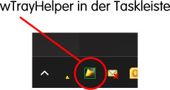
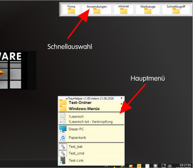
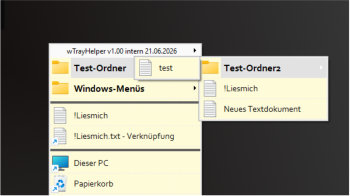
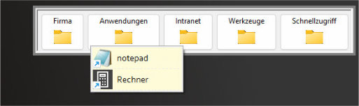
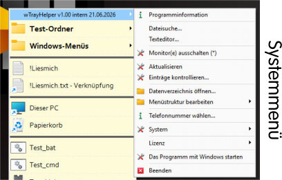

# wTrayHelper

Das Programm organisiert Deine Programme und Dateien unter Windows mit einem Klick auf die Taskleiste. Die Sortierung und die Katalogisierung legst Du selber fest. So behältst Du den Überblick!
## Funktionsübersicht

* Programmstarter mit freier Sortierung. Idealerwiese nach Kategorien und nicht nicht Programmnamen
* Freie Gestaltung der Menüstruktur mit Hilfe des MS-Explorers (Shell)
* Komplette WindowsMenüs einblendbar (ähnlich XP/Win7-Start)
* Aktivierung per Maus oder Tastenkombination
* Integrierte schnelle Dateisuche (konfigurierbar)
* Integrierter Texteditor (ANSI) als Ersatz für den "alten" MS-Editor.
* Verschiedene Systemwerkzeuge bezüglich: Computer, Monitor, Benutzer und Windows
* Optionale Telefonwahlfunktion für SNON oder Yealink mit kleinem Telefonbuch
* Überwachung von ausgewählten Verzeichnissen mit Meldung von Änderungen (Datei- Erstellung, -Löschung, -Änderung) 
* Reaktion auf USB-Ereignisse. Z.B. das Starten einen Programmes, wenn ein Barcodereader oder ein USB-Stick eingesteckt wird.
* 

## Programmübersicht
Programmlokalisation in der rechten Taskleiste.
(Darstellungen mit Musterdaten)

Menüauswahl:

Detailansicht: Haputmenü

Detailansicht: Schnellauswahl

Detailansicht: Systemmenü

# Hinweis
Hier können Sie eine Demoverion des Programmes herunterladen.
Alternativ im MS-Store.

## Systemvoraussetzungen

- Windows 10 oder Windows 11
- 32bit Applikation
- Plattenspeicher ist abhängig von der Komplexität der geplanten Menüstruktur.

## Installation

1. Setup herunterladen.
2. Setup ausführen.
3. Programm starten.

## Vollversion

Die Vollversion ist für 3€/Monat wie folgt bestellbar.
https://www.wolf-hsw.de
oder
https://shop.wolf-hsw.de

## Lizenz

Copyright © 07/2026 U.Wolf WOLF Hard- und Software. Alle Rechte vorbehalten.
